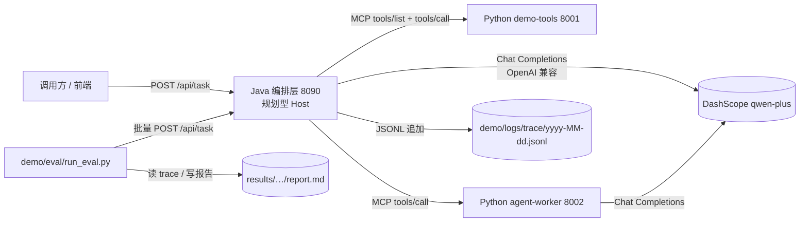
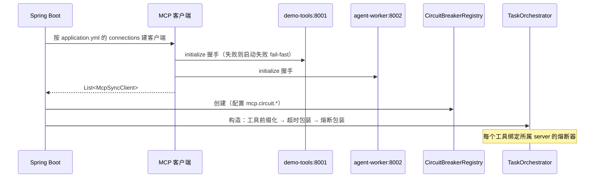
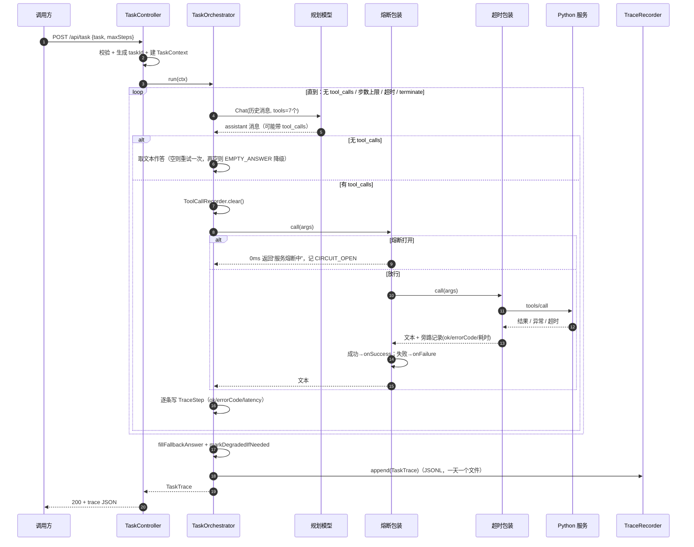
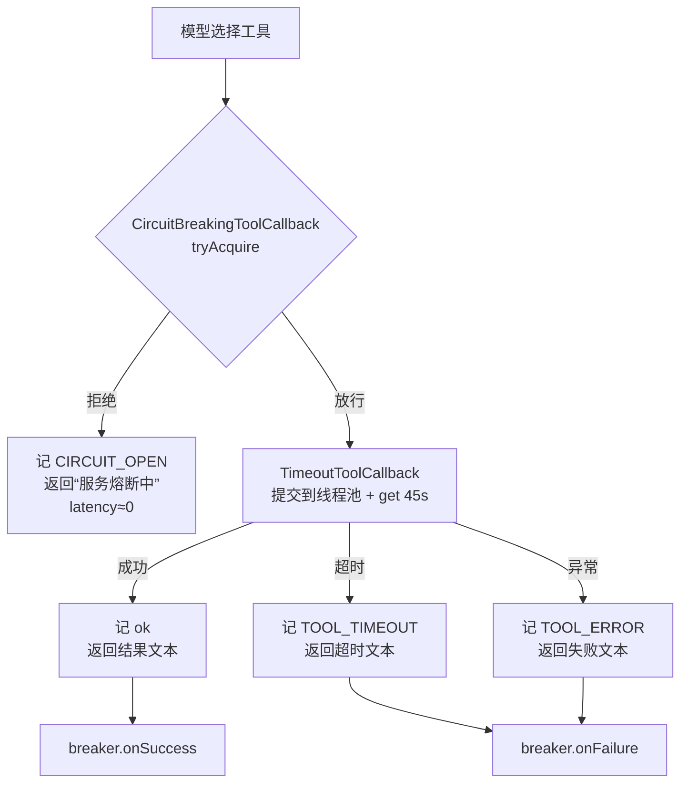
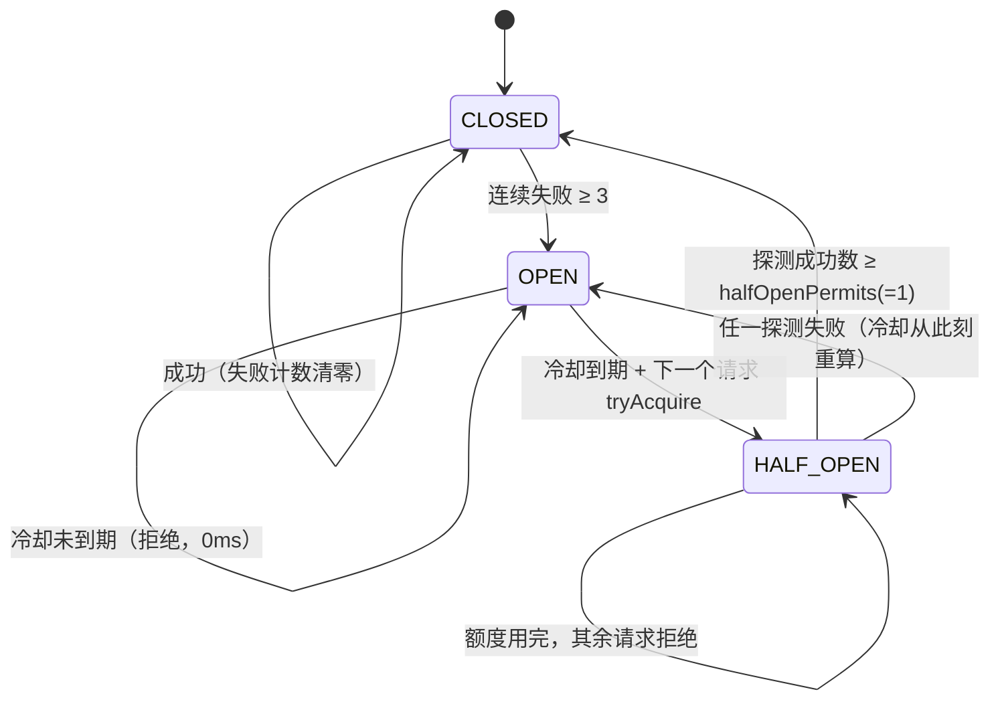
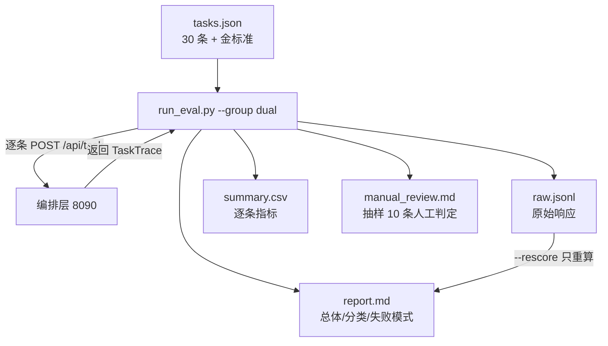

# 项目流程与调用链（图解）

> 用途：复盘整体结构；面试时能在白板上画出来。
> 图用 Mermaid，GitHub / VS Code（装 Markdown Preview Mermaid）都能直接渲染。

## 1. 系统总览



三层职责：

| 层 | 谁 | 负责 | 不负责 |
|---|---|---|---|
| Host / 规划 | Java 编排层 | 拆任务、选工具、执行 tool_calls、聚合答案、trace、熔断 | 具体能力实现 |
| 执行 | Python agent-worker | 摘要、翻译、通用兜底（内部再调一次模型） | 决定“做什么” |
| 工具 | Python demo-tools | 时间、加减 | 任何推理 |

## 2. 启动流程



**要点**：MCP 客户端初始化失败会让**整个应用起不来**（Spring AI 自动配置的默认行为）。这是已知限制，重连方案列在 backlog。

## 3. 一次任务请求的完整时序



关键点：
- **一轮可能有多个 tool_calls**，由 `ToolCallingManager.executeToolCalls` 同步执行；目前是串行（没用 `McpAsyncClient` 并行）。
- **LLM 调用超时** 60s（`mcp.planner.llm-timeout-seconds`），**单工具**超时 45s，**整任务** 300s。
- **空答案**先重试一次（追加一条“请直接给最终答复”），仍空则用最后一条工具结果兜底并标 `DEGRADED/EMPTY_ANSWER`。

## 4. 工具包装链：一次 call 的分支



顺序不能反：熔断必须在超时**外层**——否则超时被内层吞掉，熔断器收不到失败；拒绝时也进不了超时器，才能 0ms。

## 5. 熔断器状态机



配置（`application.yml`）：

```yaml
mcp:
  circuit:
    failure-threshold: 3     # 连续失败几次打开
    open-seconds: 30         # 冷却时长
    half-open-permits: 1     # 半开并发探测数
```

**一个刻意的取舍**：不做定时任务。冷却到期由“下一个真实请求”触发半开——省一个线程，代价是没流量时状态一直显示 `OPEN`。

## 6. 降级判定：什么时候算 DEGRADED

```mermaid
flowchart LR
    A[任务结束] --> B{status 还是 OK?}
    B -->|否| Z[保持原状态<br/>TIMEOUT/MAX_STEPS/ERROR]
    B -->|是| C{有失败步骤?}
    C -->|没有| D[OK<br/>全部步骤成功]
    C -->|有| E[DEGRADED<br/>errorCode=第一个失败的码<br/>degradedSteps=[...]]
```

口径：
- **OK** = 所有步骤成功 → `OK/N` 是“健康率”；
- **DEGRADED** = 至少一步失败但有答案 → `(OK+DEGRADED)/N` 是“有答案率”；
- **ERROR** = 产不出答案。

## 7. 评测流程



指标口径（脚本里写死）：
- 严格成功 = `status=OK` **且** 工具序列完全匹配 **且** 答案非空；
- 宽松成功 = 答案非空 **且** 金标准里的工具都调到了；
- 工具序列比较**剔除 `terminate`**（控制动作，单独记 `controlActions`）；
- 延迟取 trace 的 `totalLatencyMs`，算 P50/P95。

## 8. 进程与端口

```
┌─────────────────────────── 本机 ───────────────────────────┐
│ demo-tools    127.0.0.1:8001   Python MCP Server           │
│ agent-worker  127.0.0.1:8002   Python MCP Server（调模型）  │
│ 编排层        127.0.0.1:8090   Spring Boot                 │
│ 模型          dashscope.aliyuncs.com（HTTPS，公网）        │
└────────────────────────────────────────────────────────────┘
```

启动：`.\demo\start-dev.ps1`（读 `application-local.yml` 的 Key，激活 local profile）。

## 9. 数据契约：TaskTrace 长什么样

```jsonc
{
  "taskId": "t-1a2b3c4d",
  "task": "现在几点？",
  "status": "OK",                 // OK | DEGRADED | ERROR | TIMEOUT | MAX_STEPS
  "model": "qwen-plus",
  "maxSteps": 10,
  "usedSteps": 1,
  "startedAt": "...", "finishedAt": "...",
  "totalLatencyMs": 2617,
  "finalAnswer": "现在是 2026-11-02 21:30:44",
  "steps": [{
    "step": 1,
    "tool": "demotools_get_time",  // 给模型看的前缀化名字
    "serverKey": "demo-tools",     // 还原后的 server
    "args": "{}",
    "ok": true,
    "latencyMs": 41,
    "resultPreview": "[{\"text\":\"2026-11-02T21:30:44\"}]",
    "error": null,
    "errorCode": null,             // TOOL_TIMEOUT | TOOL_ERROR | CIRCUIT_OPEN
    "llmLatencyMs": 1290           // 这一轮规划的耗时
  }],
  "degraded": false,
  "errorCode": null,
  "errorMessage": null,
  "degradedSteps": [],
  "memory": {                          // 记忆层 v1：本次召回/写入了什么（可解释"为什么记得"）
    "conversationId": "u-1-s-1",       // 会话 id（请求没带 sessionId 时为自动生成的 s-<uuid>）
    "userId": "u-1",                   // 用户 id（长期记忆按它隔离）
    "recalled": [{                     // 召回的长期记忆：按 score 降序，最多 top-k 条
      "id": "6f1c9a2e-...",            // 记忆 uuid（可查看/可删除）
      "kind": "semantic",              // semantic | episodic
      "text": "用户偏好 Java 后端",     // 正文（trace 里截断 120 字）
      "score": 0.82,                   // 最终分 = 余弦 × 时间衰减（排序依据）
      "cosine": 0.86                   // 原始余弦（解释"为什么召回它"）
    }],
    "written": [{                      // 本次新写入的长期记忆（重复内容不重复写，可能为空）
      "id": "a2b7d1f0-...",            // 记忆 uuid
      "kind": "episodic",              // semantic | episodic
      "text": "会话摘要｜任务：…",      // 正文（截断 120 字）
      "confidence": 0.6,               // 置信度（"记住"0.95 / 规则 0.8 / 摘要 0.6）
      "source": "conversation:u-1-s-1" // 来源
    }],
    "injectedChars": 338               // 注入 system 段的字符数（上下文膨胀度量）
  }
}
```

## 10. 关键参数一览

| 配置 | 默认 | 含义 | 改它会影响 |
|---|---|---|---|
| `mcp.planner.model` | `qwen-plus` | 规划模型 | 工具选择质量、延迟 |
| `mcp.planner.task-timeout-seconds` | 300 | 单任务总超时 | 长任务是否被截断 |
| `mcp.planner.llm-timeout-seconds` | 60 | 单次 LLM 调用超时 | 慢模型是否被判超时 |
| `mcp.planner.tool-timeout-seconds` | 45 | 单次工具调用超时 | Agent 调模型的窗口 |
| `mcp.circuit.failure-threshold` | 3 | 连续失败阈值 | 多快熔断 |
| `mcp.circuit.open-seconds` | 30 | 冷却时长 | 多快恢复 |
| `mcp.circuit.half-open-permits` | 1 | 半开并发探测数 | 恢复期打压力度 |
| `mcp.trace.dir` | `demo/logs/trace` | trace JSONL 输出目录 | 排查时去哪找记录 |
| `mcp.memory.enabled` | `true` | 记忆层总开关 | 关掉等于退回 M6 行为 |
| `mcp.memory.db-path` | `demo/logs/memory/memory.db` | SQLite 单文件路径 | 删库即"重建记忆" |
| `mcp.memory.window.max-messages` | 20 | 短期记忆窗口（条） | 一个会话能记住多少轮 |
| `mcp.memory.recall.top-k` | 5 | 每次召回条数 | 注入量、上下文膨胀 |
| `mcp.memory.recall.min-score` | 0.35 | 余弦相似度下限 | 宁缺毋滥 vs 多召回 |
| `mcp.memory.recall.half-life-days` | 30 | 时间衰减半衰期（天） | 旧记忆的权重 |
| `mcp.memory.embedding.enabled` | `true` | 是否调用 embedding | 关掉只写不召回 |
| `mcp.memory.embedding.model` | `text-embedding-v3` | embedding 模型（与 RAG 共用） | 换它必须重建向量 |
| `mcp.memory.embedding.dimensions` | 1024 | 向量维度（实测值） | 换模型要同步改 |
| `mcp.memory.extract.enabled` | `true` | 是否抽取长期记忆 | 只读不写模式 |
| `mcp.memory.extract.default-confidence` | 0.8 | 规则命中置信度 | 以后按阈值清理记忆 |
| `mcp.memory.extract.episodic-ttl-days` | 90 | 会话摘要保留天数 | 过期后不再被召回 |
| `spring.ai.openai.base-url` | `.../compatible-mode`（**不带 /v1**） | 模型接口 | 配错直接 404 |
| `LLM_MODEL`（Python） | `qwen-plus` | 执行器模型 | 摘要/翻译质量 |
